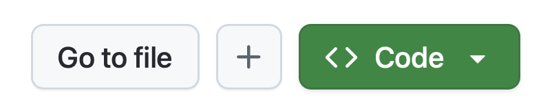

VS Code の演習を始める前に、必要な環境を準備します。Tailspin Toys リポジトリの自分用コピーと、作業用の [codespace][codespaces] を作成し、エディターで GitHub Copilot Chat が使えることを確認します。

## ラボ用リポジトリを設定する

コードの作業用コピーを作るため、[テンプレート][template-repository]からリポジトリを作成します。新しいリポジトリにはラボに必要なファイルがすべて含まれ、各演習で使用します。

1. 新しいブラウザーウィンドウで [Tailspin Toys テンプレート][tailspin-template]を開きます。
2. ラボのリポジトリページで **Use this template** を選択して自分用のコピーを作成し、**Create a new repository** を選択します。

    

3. GitHub または Microsoft が主催するイベントでワークショップに参加している場合は、メンターの案内に従います。それ以外の場合は、GitHub Copilot を利用できる組織に新しいリポジトリを作成します。

    

4. 作成したリポジトリのパス (**organization-or-user-name/repository-name**) を控えてください。このラボの後半で使用します。

> [!NOTE]
> **バックログを準備しました**
>
> テンプレートからリポジトリを作成すると、GitHub issue のバックログも自動的に作成されます。ワークショップではこの issue を使うため、自分で作成する必要はありません。

## codespace を作成する

次に、ラボの演習を行うための codespace を作成します。

[GitHub Codespaces][codespaces] は、ブラウザーで直接コードの記述、実行、デバッグができるクラウド開発環境です。複数のプログラミング言語、拡張機能、ツールをサポートする、すべての機能を備えた IDE を利用できます。

1. 作成したリポジトリを開きます。
2. 緑色の **Code** ボタンを選択します。

    

3. **Codespaces** タブを選択し、**+** ボタンを選択して新しい Codespace を作成します。

    

codespace の作成には数分かかりますが、サービスを手動でインストールするよりもはるかに短時間で済みます。作成中に GitHub Copilot の他の機能を確認しておきましょう。次の演習から使い始めます。

> [!CAUTION]
> 今後の演習で codespace に戻ります。今はブラウザーのタブを閉じずに開いたままにしてください。

> [!NOTE]
> このワークショップは codespace またはローカルの [dev container][dev-containers] で実行できます。どちらも、スムーズに作業できるよう必要な前提条件を備えています。ローカルで実行する場合は、クローンしたリポジトリを VS Code で開き、表示されたら **Reopen in Container** を選択してください。codespace と同じ dev container が構築されます。

[codespaces]: https://github.com/features/codespaces
[dev-containers]: https://code.visualstudio.com/docs/devcontainers/containers

## GitHub Copilot Chat とエージェントモードを使う

VS Code で GitHub Copilot Chat のエージェントモードを使うには、IDE に GitHub Copilot Chat 拡張機能がインストールされている必要があります。GitHub Codespace を使用している場合は、すでにインストールされているはずです。

> [!TIP]
> GitHub Copilot Chat 拡張機能がインストールされていない場合は、[Visual Studio Code Marketplace からインストール][copilot-chat-extension]できます。Visual Studio Code の Extensions ビューを開き、**GitHub Copilot Chat** を検索して **Install** を選択する方法もあります。

拡張機能をインストールした後、GitHub アカウントで認証する必要がある場合があります。

1. Codespace に戻ります。
2. エディターの右側に Copilot Chat が表示されていない場合は、codespace の上部にある **Copilot Chat** アイコンを選択します。
3. Copilot Chat ウィンドウに「Hello world」のようなメッセージを入力し、Enter キーを押します。Copilot Chat が起動します。
4. 認証されていない場合は、GitHub アカウントへのサインインを求められます。表示される手順に従って認証します。

    

5. 認証後、Copilot Chat ウィンドウが表示されます。

## まとめ

ラボ用リポジトリのコピーを作成し、コードを書き始めるための codespace の作成を開始できました。

## 次のステップ

Copilot を使い始めましょう。[演習 1 - カスタム指示][next-lesson]に進み、Copilot にプロジェクトの慣習を伝えます。

## リソース

- [GitHub Codespaces の概要][codespaces]
- [テンプレートからリポジトリを作成する][template-repository]
- [Codespaces の使用を開始する][codespaces-quickstart]

[tailspin-template]: https://github.com/github-samples/tailspin-toys
[template-repository]: https://docs.github.com/repositories/creating-and-managing-repositories/creating-a-template-repository
[codespaces-quickstart]: https://docs.github.com/codespaces/getting-started/quickstart
[copilot-chat-extension]: https://marketplace.visualstudio.com/items?itemName=GitHub.copilot-chat
[next-lesson]: ../1-custom-instructions/
